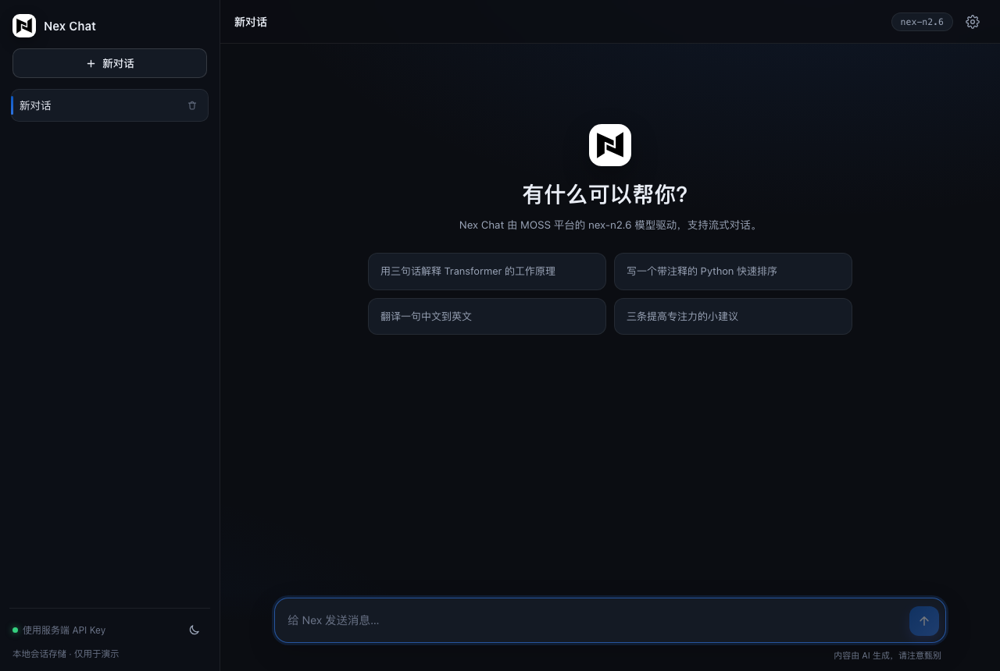

# Nex Chat

基于 MOSS 平台 **nex-n2.6** 模型的对话演示：原生 HTML/CSS/JavaScript 前端 + 零依赖 Node 代理服务。品牌标识与视觉取自官方站点 [nex-agi.cn](https://nex-agi.cn/)。

**不需要安装依赖，不需要前端构建，不需要数据库。** 填好 API Key，一条命令即可运行。



## 功能

- 流式回复（SSE 逐字输出），支持停止生成、重新生成、复制回答
- 多会话管理：新建、切换、双击重命名、删除，标题自动取自首条消息
- 思考过程展示（模型返回 `reasoning_content` 时折叠显示）
- Markdown 渲染：标题、列表、引用、链接、行内代码、代码块（带复制按钮）
- 非流式模式、`max_tokens`、系统提示词、思考模式可在「设置」里切换
- 每轮回复展示 token 用量（输入 / 输出 / 合计 / 思考）与生成速度（tokens/s）
- 深浅色主题、移动端侧边栏、中文输入法回车保护
- 会话保存在浏览器 `localStorage`，刷新不丢失

## 适合谁

- 想快速体验 `nex-n2.6` 对话效果的人
- 想学习 Chat Completions / SSE 流式调用写法的开发者
- 想在此基础上改成自己的小工具的人

本项目定位是**本地演示**，不是生产级产品。公网部署前请先阅读文末的安全提醒。

## 环境要求

| 项目 | 要求 |
| --- | --- |
| Node.js | **20.6 及以上**（`node -v` 查看；推荐 22/24 LTS） |
| 浏览器 | Chrome、Edge、Safari 等现代浏览器 |
| 网络 | 能访问 `https://api.mosi.cn` |
| MOSS API Key | 需在 MOSS 平台申请，见下一步 |

没有安装 Node？到 <https://nodejs.org/> 下载 LTS 安装包，一路默认安装即可。装完重新打开终端执行 `node -v` 确认版本。

## 三步开始使用

### 第 1 步：获取 API Key

1. 登录 MOSS 开放平台 <https://platform.moss.cn/>。
2. 在控制台/API Key 管理页面创建一个 Key，复制形如 `sk-...` 的字符串。
3. 确认账号已开通 `nex-n2.6` 模型权限。

> Key 等同于账号密码，不要发到公开仓库、截图或群聊里。如果页面里找不到创建入口，请向平台管理员申请。

### 第 2 步：启动服务

先进入项目目录：

```bash
cd nex-chat
```

然后任选一种方式。

**方式 A：环境变量启动（推荐，Key 不落盘、不进浏览器）**

macOS / Linux：

```bash
MOSS_API_KEY=你的Key node server.js
```

Windows PowerShell：

```powershell
$env:MOSS_API_KEY="你的Key"
node server.js
```

Windows CMD：

```bat
set MOSS_API_KEY=你的Key
node server.js
```

**方式 B：`.env` 文件启动（适合长期使用）**

macOS / Linux：

```bash
cp .env.example .env
```

Windows：

```bat
copy .env.example .env
```

用任意文本编辑器打开 `.env`，在 `MOSS_API_KEY=` 后面粘贴 Key：

```dotenv
MOSS_API_KEY=sk-你的Key
MOSS_API_ORIGIN=https://api.mosi.cn
PORT=3000
```

保存后启动：

```bash
node --env-file=.env server.js
```

**方式 C：页面里填 Key（最省事，适合临时试用）**

```bash
node server.js
```

启动后在页面「设置」中粘贴 Key。Key 保存在当前浏览器的 `localStorage`，换浏览器或清理站点数据后需要重填。

> 也可以直接执行 `npm start` 启动（本项目没有依赖，无需先 `npm install`）。

启动成功后终端会显示：

```
Nex Chat 已启动: http://localhost:3000
MOSS API 地址: https://api.mosi.cn
API Key: 使用服务端环境变量 MOSS_API_KEY
```

### 第 3 步：开始对话

1. 打开 <http://localhost:3000>。
2. 如果还没配置 Key，页面会自动弹出「设置」，粘贴 Key 后点「保存」。
3. 在底部输入框提问，或点击页面中的建议问题。
4. `Enter` 发送，`Shift + Enter` 换行；生成过程中可点右侧方块按钮停止。
5. 回复下方会显示 token 用量；鼠标移到回复上可复制或重新生成。

## 界面与使用流程

### 一次完整的对话

1. 点击「新对话」开始一个干净会话（首次进入已自动创建）。
2. 输入问题发送，等待流式输出。
3. 需要中断时点「停止」，已生成的部分会保留并标注「已停止生成」。
4. 不满意可点「重新生成」；对非最后一条回答重新生成前会弹窗确认，因为其后的对话会被移除。
5. 继续追问即可，模型会携带当前会话的历史消息。

### 会话管理

| 操作 | 方法 |
| --- | --- |
| 新建会话 | 侧边栏顶部「新对话」 |
| 切换会话 | 点击侧边栏中的会话 |
| 重命名 | 双击会话标题，回车保存，Esc 取消 |
| 删除 | 悬停会话，点右侧垃圾桶图标 |
| 清空全部 | 设置弹窗底部「清空全部对话」（只清会话，不清 Key 和设置） |
| 切换主题 | 侧边栏底部月亮/太阳图标 |
| 移动端 | 点左上角菜单按钮展开侧边栏 |

### 设置项说明

点右上角齿轮打开设置：

| 设置项 | 默认值 | 说明 | 新手建议 |
| --- | --- | --- | --- |
| API Key | 空 | 页面本地保存的 Key；服务端已配置环境变量时可留空 | 长期使用建议用环境变量 |
| 模型 | `nex-n2.6` | 请求中的 `model` 字段，修改后对新消息生效 | 保持默认 |
| 最大输出 Token | `8192` | 单次回答上限，范围 1–131072；越大可能越慢 | 4096–8192 足够日常使用 |
| 系统提示词 | 空 | 作为 `system` 消息插在对话最前面，可设定回答风格 | 可选，例如「用中文简洁回答」 |
| 流式输出 | 开启 | 开启后逐字返回；关闭则一次性返回完整结果 | 保持开启 |
| 开启思考模式 | 关闭 | 请求携带 `thinking.type = "enabled"`，返回的思考内容折叠展示 | 需要推理过程时开启 |

### API Key 的三种配置方式（优先级从高到低）

1. **服务端环境变量** `MOSS_API_KEY`：进程启动时读取，不会出现在浏览器里，最安全。
2. **页面「设置」中的 Key**：保存在浏览器 `localStorage`，使用方便，但同一台电脑的其他使用者可能读取到。
3. **两者都没有**：请求返回 401，并在界面提示缺少 Key。

两处都配置时，**服务端环境变量优先**，页面的 Key 会被忽略。

### 环境变量

| 变量 | 默认值 | 说明 |
| --- | --- | --- |
| `MOSS_API_KEY` | 空 | 服务端 Key，优先级高于浏览器里填的 Key |
| `MOSS_API_ORIGIN` | `https://api.mosi.cn` | MOSS API 地址，一般不用改 |
| `PORT` | `3000` | 本地服务端口，被占用时可改 |

> `.env` 已被 `.gitignore` 忽略，不要把真实 Key 提交到仓库。

## 常见问题排查

**启动时报 `node: command not found`**

Node 没装或不在 PATH 中。安装 Node 20.6+ 后重开终端，`node -v` 能输出版本即可。

**启动时报 `EADDRINUSE` / 端口被占用**

换个端口启动：

```bash
PORT=3001 node server.js
```

Windows PowerShell：`$env:PORT="3001"; node server.js`，然后访问 <http://localhost:3001>。

**页面提示「缺少 API Key」**

没有配置任何 Key。用方式 A/B 启动，或在页面「设置」中填写后保存。

**接口返回「API Key 无效」**

确认 Key 复制完整、没有多余空格；页面里不需要手动加 `Bearer` 前缀。仍失败时到 MOSS 平台确认 Key 状态和模型权限。

**接口返回 429**

并发超限。平台限制为每用户每模型 10 个并发请求，等待片刻再试。

**接口返回 400 `invalid_field_value`**

通常是请求字段取值不支持。本项目的思考模式只发送 `thinking.type = "enabled"`，不支持 `"disabled"`；若手改过请求参数，请恢复默认。

**页面一直转圈 / 请求失败**

先确认电脑能访问 `https://api.mosi.cn`，公司网络或代理可能拦截。可在终端执行：

```bash
curl -I https://api.mosi.cn
```

再点错误卡片上的「重试」。

**回复被截断**

输出达到「最大输出 Token」上限，调大设置里的数值后重新生成。也会在界面上提示截断原因。

**刷新后对话还在吗？怎么彻底删除？**

对话保存在当前浏览器 `localStorage`。刷新不丢；设置里「清空全部对话」会删除所有会话；清理浏览器站点数据会连同页面里保存的 Key 一起清除。

**手机能访问吗？**

手机与电脑连同一 Wi-Fi，在手机浏览器打开 `http://电脑局域网IP:3000`（如 `http://192.168.1.23:3000`），Key 建议放服务端环境变量。**仅限可信局域网**，不要直接开放到公网。

**为什么没有 temperature 参数？**

本项目只发送 MOSS Chat Completions 文档中列出的字段，平台文档未提供 `temperature`，因此界面也不展示该设置。

**能发图片/视频吗？**

接口本身支持图片 URL/base64 与 MP4/WebM 视频内容，但本演示界面只做了文本输入，没有上传控件；需要时可基于 `server.js` 的代理自行扩展。

## 目录结构

```
nex-chat/
├── server.js            # Node HTTP 服务：静态托管 + /api/chat 代理 + /api/config
├── package.json
├── .env.example
├── docs/
│   └── preview.png      # 界面预览图
└── public/
    ├── index.html       # 聊天界面结构、设置弹窗
    ├── style.css        # 深浅色主题、响应式布局
    ├── app.js           # 会话状态、Markdown 渲染、SSE 解析、事件绑定
    ├── favicon.svg      # 官方站点图标
    └── logo/
        └── nex.svg      # 官方 Nex Logo
```

## 品牌资源

界面中的 Nex 标识来自官方站点 [nex-agi.cn](https://nex-agi.cn/)：

- `public/logo/nex.svg` — 对应官网 `logo/nex.svg`
- `public/favicon.svg` — 对应官网 `favicon.svg`

标识版权归官方所有，本项目仅作演示引用。

## MOSS API 调用说明

本项目使用 Chat Completions 接口。

- 地址：`POST https://api.mosi.cn/v1/chat/completions`
- 鉴权：`Authorization: Bearer <API Key>`
- 模型：`nex-n2.6`（快照 `nex-n2.6-2026-11-05`）
- 兼容 OpenAI SDK：`base_url` 填 `https://api.mosi.cn/v1`

最小请求：

```bash
curl https://api.mosi.cn/v1/chat/completions \
  -H "Content-Type: application/json" \
  -H "Authorization: Bearer $MOSS_API_KEY" \
  -d '{
    "model": "nex-n2.6",
    "messages": [{ "role": "user", "content": "用三句话解释什么是 Transformer" }],
    "max_tokens": 1024
  }'
```

流式请求（本项目默认）：

```bash
curl -N https://api.mosi.cn/v1/chat/completions \
  -H "Content-Type: application/json" \
  -H "Authorization: Bearer $MOSS_API_KEY" \
  -d '{
    "model": "nex-n2.6",
    "messages": [{ "role": "user", "content": "写一段快速排序" }],
    "stream": true,
    "stream_options": { "include_usage": true }
  }'
```

流式响应是 SSE，每个事件形如：

```
data: {"object":"chat.completion.chunk","choices":[{"index":0,"delta":{"content":"你"}}]}

data: {"object":"chat.completion.chunk","choices":[{"index":0,"delta":{"content":"好"}}]}

data: [DONE]
```

拼接所有 `choices[0].delta.content` 即完整回答；带思考模式时还会出现 `delta.reasoning_content`。末尾可能有一条 `choices` 为空数组的用量事件，解析时需先判空。

### 请求参数（本项目用到的部分）

| 参数 | 说明 |
| --- | --- |
| `model` | 必填，如 `nex-n2.6` |
| `messages` | 必填，`[{role, content}]`；`content` 可为字符串或 `text`/`image_url`/`video_url` 内容数组 |
| `max_tokens` | 输出上限，默认 8192，最大 131072 |
| `stream` | 是否流式返回 |
| `stream_options.include_usage` | 流式时在末尾附带 token 用量 |
| `thinking` | `{"type":"enabled"}` 开启深度思考；不支持 `disabled` |
| `system` 消息 | 本项目在 `messages` 最前面插入 `system` 提示词 |

图片/视频可作为消息内容传入：图片支持 HTTPS URL 或 base64 data URL，视频支持 MP4/WebM 的 `video_url`；整个请求体编码后不超过 10 MiB，音频暂不支持。

### 响应中的用量

```json
"usage": {
  "prompt_tokens": 26,
  "completion_tokens": 128,
  "total_tokens": 154,
  "completion_tokens_details": { "reasoning_tokens": 0 }
}
```

界面底部的 mono 小字就是由这些字段拼出的；生成速度由 `completion_tokens` 除以实际生成耗时得出：流式按首个输出片段到结束计时，显示解码速度；非流式无法区分首字延迟，按请求总耗时计算并标注为「平均」。当前模型限时免费，但接口仍会返回用量。

### 错误处理

- 先检查 HTTP 状态码，再读 `error.message`
- 流式过程中连接提前断开时，按「未完整返回」处理（界面会给出提示）
- 并发限制为每用户每模型 10 个请求

## 实现要点

- `server.js` 用 `res.on('close')` 加 `!res.writableEnded` 判断真实断开，避免正常结束时误取消上游请求
- `public/app.js` 的 `consumeStream()` 手动处理 SSE 分帧：网络分片先入缓冲区，按 `\n\n` 切事件，兼容 `\r\n`，遇到 `data: [DONE]` 结束
- Markdown 渲染先用 `escapeHtml` 转义，再处理行内格式，链接仅允许 `https?://`，避免 XSS
- 中文输入法组合期间的回车不触发发送（检查 `e.isComposing`）

## 安全提醒

- 本项目代理**没有鉴权与限流**，只适合本机或可信局域网使用，不要直接暴露到公网。
- 生产环境请把 Key 只放在服务端，并为代理增加访问控制、速率限制和日志脱敏。
- 共用电脑建议使用服务端环境变量，并在离开前清空页面里保存的 Key。
- 请遵守 MOSS 平台的使用条款与计费规则。

## 相关文档

- 模型说明：<https://platform.moss.cn/docs/models/nex>
- 接口参考：<https://platform.moss.cn/docs/reference/chat-completions>
- 官方站点：<https://nex-agi.cn/>
